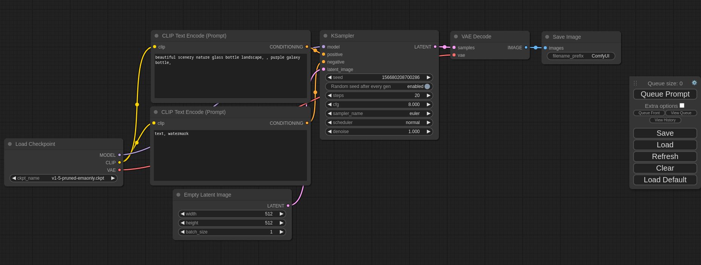

## What Is ComfyUI?

**ComfyUI** is a free, open-source app for generating images with AI models such as Stable Diffusion, on your own computer. There's no subscription and no per-image cost, and your prompts and pictures never leave your PC.

It looks different from a chatbot: instead of one text box, you see a **workflow**, a set of connected boxes ("nodes") for each step: load the model, write the prompt, generate, save. That looks intimidating at first, but the default workflow already does everything; you only change the text and press Run. The same flexibility is why it's popular: later you can swap in newer models or add steps like upscaling.

If you set up [local AI chat on your gaming PC](/tutorials/local-ai-gaming-pc-ollama), this is the picture-making counterpart, and the same rule applies: **your graphics card's VRAM decides what you can run.**

## What You'll Need

- Windows 10 or 11
- A dedicated graphics card. ComfyUI also runs without one, but extremely slowly. NVIDIA cards are the best supported; recent AMD cards work too.
- 16GB of system RAM is a comfortable minimum
- Disk space: about 5GB for the app, plus 2–20GB per model

---

## Step 1: Install ComfyUI Desktop

1. Download the installer from **comfy.org/download**. The page picks the Windows version for you.
2. Run the `.exe` and follow the prompts.
3. Launch **ComfyUI** from the Start menu. On first launch it asks whether to run in the cloud or **installed locally on this machine**: choose local.

Setup then installs its Python environment, which takes a few minutes.

---

## Step 2: Get a First Model

When ComfyUI opens, it shows its default text-to-image workflow, built for a **Stable Diffusion 1.5** model. That's an older, small model that runs on almost any graphics card, which makes it the right first test.

If the model isn't on your PC yet, ComfyUI shows a missing-model warning. Click it, then **Download**. The app fetches the file (usually from Hugging Face) into its `models/checkpoints` folder; progress shows in the sidebar.

When it's done, press **R** to refresh, and check the **Load Checkpoint** box at the left shows the downloaded model.

---

## Step 3: Write a Prompt and Generate

*ComfyUI's default text-to-image workflow: each box is one step, connected left to right.*

The default workflow has two text boxes labeled **CLIP Text Encode**:

- **The top one is your prompt**: describe the picture, such as *a cozy living room at night, a big TV showing a starry sky, warm lamp light, photo*.
- **The bottom one is the "negative" prompt**: things you don't want, such as *blurry, low quality, text, watermark*.

Click **Run** (or press `Ctrl+Enter`). A few seconds later, the image appears in the **Save Image** box at the right. It's also saved to ComfyUI's `output` folder; right-click the picture to save a copy elsewhere.

Run it again for a different image: each run uses a new random "seed". To refine an image you like, keep its seed fixed in the **KSampler** box (set **control after generate** to *fixed*) and change the prompt.

---

## Step 4: Try Better Models

Stable Diffusion 1.5 proves everything works, but newer models are much better at realistic detail, hands and text. ComfyUI includes ready-made workflow templates for newer models; open the templates browser from its menu, pick one, and download the models it asks for.

As a rough guide to what your card can handle:

| VRAM | What runs comfortably |
|---|---|
| 6–8GB | Stable Diffusion 1.5; SDXL with patience |
| 12GB | SDXL; smaller or compressed versions of the newest models |
| 16GB or more | the newest, largest image models |

If a model doesn't fit, generation gets very slow or fails with an "out of memory" error; pick a smaller model or a compressed version of it.

---

## Using Images Responsibly

- **Check each model's license.** Some allow commercial use, others are for personal or non-commercial use only. The license is on the model's download page.
- **Don't create images of real people** without their consent, or images meant to deceive.
- **Label AI images** when you share them, so nobody mistakes them for photos.

---

## Troubleshooting

**"Out of memory" or a crash during generation:** the model or image size is too big for your VRAM. Close games and other GPU-heavy apps, lower the width and height in the **Empty Latent Image** box, or use a smaller model.

**Very slow (minutes per image):** ComfyUI may be running on the CPU. Check that your graphics driver is up to date and that ComfyUI's settings show your GPU.

**A model download never starts:** download the file from the link in the warning yourself and put it in the `models/checkpoints` folder shown in ComfyUI's settings, then press **R**.

**Faces or hands look wrong:** that's typical of older models. Try SDXL or a newer model, and describe the subject more precisely.
