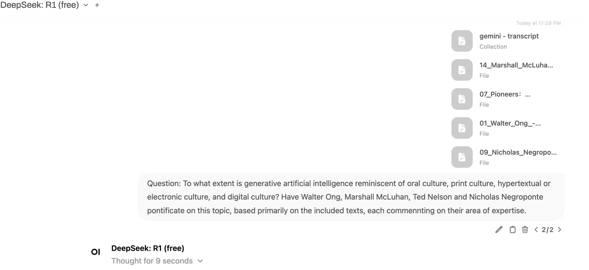

## What You're Building

Ollama runs AI models, but on its own you chat with it in a terminal. **Open WebUI** is a free, open-source web app that gives it a familiar ChatGPT-style interface: a chat list, model picker, file uploads and separate accounts for everyone in the house. Chats are stored on your own server, and nothing goes to a third party unless you add a cloud API key yourself.

This tutorial runs Open WebUI with Docker on the same machine as Ollama. That can be:

- **A Raspberry Pi 5**, set up with our [local LLM on Raspberry Pi tutorial](/tutorials/run-local-llm-raspberry-pi). Fine for small 1–3B models.
- **A PC with a graphics card** for faster, larger models. See our [local AI on a gaming PC tutorial](/tutorials/local-ai-gaming-pc-ollama).

The commands below are for the Pi (or any Linux machine). On Windows, install Docker Desktop and run the same `docker run` command in PowerShell.

## What You'll Need

- Ollama installed with at least one model pulled (`ollama list` shows them)
- Raspberry Pi OS (64-bit) or another Linux, with internet access for the first install
- About 2GB of free disk space for Open WebUI

---

## Step 1: Let Docker Containers Reach Ollama

Open WebUI runs in a container, which counts as "another machine" to Ollama. Ollama only listens to the machine it runs on by default, so make it listen on the network. On the Pi:

```bash
sudo systemctl edit ollama.service
```

Add these lines and save:

```ini
[Service]
Environment="OLLAMA_HOST=0.0.0.0"
```

Restart Ollama and check it answers:

```bash
sudo systemctl restart ollama
curl http://localhost:11434/api/tags
```

This is the same step as the optional Step 4 of our Pi LLM tutorial. Only do it on a trusted home network, and never forward port 11434 on your router.

---

## Step 2: Install Docker

Docker's convenience script installs the current version on Raspberry Pi OS:

```bash
curl -fsSL https://get.docker.com | sh
sudo usermod -aG docker $USER
```

Log out and back in (or reboot) so the second command takes effect, then check:

```bash
docker run --rm hello-world
```

---

## Step 3: Start Open WebUI

Generate a secret key for signing logins:

```bash
openssl rand -hex 32
```

Then start Open WebUI, pasting your key in place of `YOUR-SECRET-KEY`:

```bash
docker run -d -p 3000:8080 \
  --add-host=host.docker.internal:host-gateway \
  -v open-webui:/app/backend/data \
  -e WEBUI_SECRET_KEY=YOUR-SECRET-KEY \
  --name open-webui --restart always \
  ghcr.io/open-webui/open-webui:main
```

What the options do:

- `-p 3000:8080` serves the web page on port 3000.
- `--add-host=host.docker.internal:host-gateway` lets the container find Ollama on the same machine; Open WebUI looks for it at `http://host.docker.internal:11434` automatically.
- `-v open-webui:/app/backend/data` keeps your accounts and chats in a Docker volume, so they survive updates.
- `--restart always` starts it again after a reboot.

The first start downloads the image (a few minutes on a Pi). Follow along with `docker logs -f open-webui`, and press `Ctrl+C` to stop watching.

---

## Step 4: Create the Admin Account

On any device at home, open `http://YOUR-SERVER-IP:3000` (find the IP with `hostname -I`).

The first screen offers **Create Admin Account**. The first account becomes the administrator, and after that, sign-ups are switched off automatically.

Pick a model from the menu at the top of a new chat and say hello. If the model list is empty, Open WebUI can't reach Ollama; go back to Step 1.


*Open WebUI's chat screen. You can attach documents and ask questions about them.*

---

## Step 5: Add Your Household

To give family members their own accounts and chat history:

1. Go to **Admin Panel → Settings → Authentication** (the exact menu wording can vary between versions) and turn on **New Sign Ups**.
2. Have each person open the same address and sign up.
3. New accounts wait as **Pending** until you approve them under **Admin Panel → Users**.

Turn sign-ups off again when everyone's in.

On phones, use the browser's **Add to Home Screen** option and Open WebUI works like an app.

---

## Tips

- **Match the model to the hardware.** On a Pi 5, stick to 1–3B models; Open WebUI itself uses some memory too. Larger models belong on a PC with a graphics card.
- **Save prompts you reuse.** Open WebUI can store prompt templates; our [AI prompt library](/ai/prompts) has streaming and home-tech prompts that work well with local models.
- **Keep it at home.** Like Ollama, don't forward Open WebUI's port on your router. To use it away from home, a private network tool such as Tailscale (see our [Jellyfin remote access tutorial](/tutorials/jellyfin-remote-access-tailscale)) is the safe way.

---

## Updating Open WebUI

Pull the new image, remove the old container and start it again with the same command as Step 3. Your data lives in the `open-webui` volume, so nothing is lost:

```bash
docker pull ghcr.io/open-webui/open-webui:main
docker stop open-webui && docker rm open-webui
# then run the Step 3 docker run command again
```

---

## Troubleshooting

**No models in the menu:** check `curl http://localhost:11434/api/tags` on the server lists your models, and that Ollama has `OLLAMA_HOST=0.0.0.0` (Step 1).

**The page doesn't load:** check the container is running with `docker ps`. If port 3000 is taken, change the first number in `-p 3000:8080`.

**Replies are very slow:** the model is too big for the hardware. Try a smaller one, such as `llama3.2:1b` on a Pi.

**Forgot the admin password:** the reset steps are in Open WebUI's documentation; they involve editing the database inside the volume, so back up the volume first.
